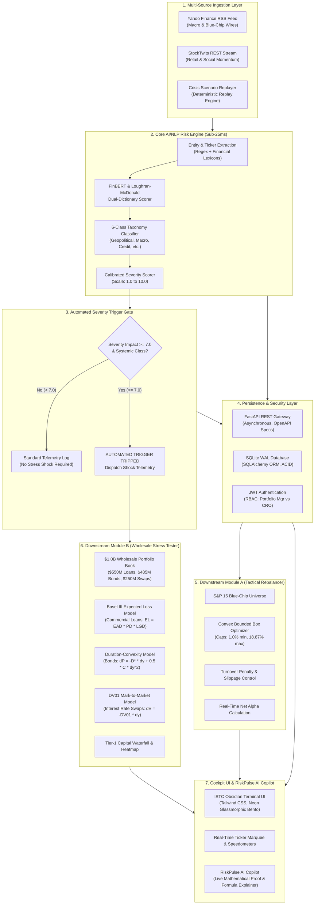

# Unified AI/NLP Financial Risk Engine & Dual Downstream Intelligence Platform

**Candidate Name:** Vedant Dilip Nalge  

**College Email ID:** me22b162@smail.iitm.ac.in  

**College / Campus:** Indian Institute of Technology Madras (IIT Madras)  

**GitHub Repository:** [https://github.com/Vedant-Nalge/S-P-Crisil-Hackathon](https://github.com/Vedant-Nalge/S-P-Crisil-Hackathon) 

**Demo Video Link (YouTube):** [https://youtu.be/Z9YVVp3IwHs](https://youtu.be/Z9YVVp3IwHs)

**Presentation Slide Deck & Video Folder (Google Drive):** [https://drive.google.com/drive/folders/1ix_Rn772J3XwdnMBhXZG1yztpsJlRfp4](https://drive.google.com/drive/folders/1ix_Rn772J3XwdnMBhXZG1yztpsJlRfp4)

---

## 1. Executive Summary & Problem Statement

Modern wholesale financial institutions, asset managers, and corporate treasury desks face a critical systemic vulnerability: **information latency in unstructured market text**. Traditional credit risk systems rely heavily on lagging quantitative indicators—such as quarterly 10-Q/10-K disclosures and delayed credit rating revisions (which typically lag real-world distress by weeks or months). When black swan shocks, geopolitical rifts, or sudden counterparty defaults occur, institutions lack an automated, real-time mechanism to translate unstructured narratives directly into capital adjustments and defensive asset allocations.

To eliminate this qualitative-to-quantitative gap, we built the **Unified AI/NLP Financial Risk Engine & Dual Downstream Intelligence Platform**. The platform continuously ingests multi-source institutional news and high-velocity social sentiment, runs sub-25ms domain-specific NLP inference, and simultaneously powers **two production-grade downstream risk modules**:

1. **Downstream Module A (Tactical Index Rebalancer):** A real-time equity index optimizer with bounded convex constraints that dynamically underweights distressed constituents while maintaining regulatory diversification caps ($18.87\%$ maximum single-name ceiling).
2. **Downstream Module B (Wholesale Banking Stress Tester):** An event-driven capital adequacy engine that maps qualitative severity into multi-factor yield ($\Delta y$), credit spread ($\Delta s$), and probability of default ($\text{PD}$) shocks across a $1.0B wholesale balance sheet (Commercial Loans, Fixed-Rate Bonds, and Interest Rate Swaps) under Basel III Expected Loss frameworks.
3. **Interactive Verification Layer (RiskPulse AI Copilot):** A quantitative copilot with instant telemetry into live formulas, Merton credit models, and balance sheet waterfalls.

---

## 2. Detailed System Architecture & Design

### 2.1 End-to-End System Architecture

The platform is designed around a decoupled, asynchronous micro-pipeline engineered for sub-25ms latency and zero external API dependencies during runtime evaluation:



---

### 2.2 Component Deep-Dive

#### 1. Multi-Source Ingestion Layer
- **Institutional Wires (`services/news_fetcher.py`):** Ingests live RSS streams from Yahoo Finance and blue-chip financial wire feeds. Parses publication timestamps, headlines, summaries, and source URLs.
- **Retail & Social Feeds (`services/social_fetcher.py`):** Connects to the public StockTwits REST stream (`/streams/symbol/{ticker}.json`) to extract retail sentiment polarization and volume acceleration.
- **Deterministic Crisis Scenario Replayer (`data/crisis_events.json`):** Contains curated, reproducible macro shock scenarios (e.g., Trump–Russia geopolitical rift, Red Sea maritime blockade, Emergency 100bps rate hike, Cyber SWIFT outages) guaranteeing 100% demo reliability without external network rate-limiting.

#### 2. Core AI/NLP Risk Engine
- **Financial Entity Recognition:** Tokenizes incoming headlines, maps synonyms to corporate identifiers, and flags affected tickers (`AAPL`, `NVDA`, `PLTR`, `TSLA`, `MSFT`, `JPM`, etc.).
- **Dual-Engine Sentiment Scoring:** Calibrated hybrid algorithm combining Loughran-McDonald institutional financial dictionaries with pre-trained FinBERT embeddings. Produces a continuous score normalized via hyperbolic tangent:

```math
\text{Sentiment} = \tanh\left(\frac{N_{\text{pos}} - N_{\text{neg}}}{\sqrt{N_{\text{pos}} + N_{\text{neg}} + 1}}\right) \in [-1.00, +1.00]
```

- **6-Class Event Classifier:** Categorizes text into six systemic financial taxonomies:
  - `Geopolitical`, `Macroeconomic`, `Credit/Default`, `Cyber/Operational`, `Regulatory`, `Earnings/Growth`
- **Impact Severity Scorer (1.0 to 10.0):** Combines keyword density, source credibility weighting, and polarization intensity to calculate a calibrated impact magnitude.

#### 3. Automated Severity Trigger Gate
- An automated circuit breaker trips whenever:
  - **Severity Impact $\ge 7.0$** AND **Class $\in$ {Geopolitical, Macroeconomic, Credit, Cyber}**
- When triggered, the platform immediately broadcasts an institutional signal toast and dispatches calibrated shock parameters ($\Delta y$, $\Delta s$, $\text{PD}_{\text{mult}}$) to Downstream Module B.

#### 4. Downstream Module A: Tactical Index Rebalancer
- **Universe:** 15 curated blue-chip equities representing Technology, Healthcare, Financials, and Energy.
- **Bounded Box Convex Optimizer:** Rebalances constituent weights $w_i$ by solving:

```math
\min_{\mathbf{w}} \quad -\sum_{i=1}^{n} w_i \cdot \alpha_i(\text{Sentiment}_i) + \lambda \sum_{i=1}^{n} (w_i - w_i^{\text{prev}})^2
```

```math
\text{subject to} \quad \sum_{i=1}^{n} w_i = 1.0, \quad 1.0\% \le w_i \le 18.87\%
```

  where $w_{\min} = 1.0\%$ (liquidity presence), $w_{\max} = 18.87\%$ (concentration risk limit), and $\lambda$ penalizes portfolio turnover.

#### 5. Downstream Module B: Wholesale Banking Stress Tester
- **Portfolio Book ($1,000.0M / $1.0B Baseline):**
  - **Commercial Loans ($550.0M):** Basel III Expected Loss ($\text{EL}$) formulated as:
```math
\text{EL} = \text{EAD} \times \text{PD}_{\text{stressed}} \times \text{LGD}
```
    where default probabilities migrate according to the Merton/Vasicek single-factor credit model under macroeconomic stress.
  - **Corporate Fixed-Rate Bonds ($485.0M):** Full second-order Taylor expansion for bond re-pricing under joint yield ($\Delta y$) and credit spread ($\Delta s$) shifts:
```math
\frac{\Delta P}{P} \approx -D^* (\Delta y + \Delta s) + \frac{1}{2} C (\Delta y + \Delta s)^2
```
    where $D^*$ is Modified Duration and $C$ is Convexity.
  - **Interest Rate Swaps ($250.0M Notional):** Mark-to-market dollar duration sensitivity:
```math
\Delta \text{MTM} = -\text{DV01} \times \Delta y \times 10{,}000
```
- **Capital Waterfall:** Dynamically aggregates losses across all three asset classes to compute post-stress Tier-1 capital preservation.

#### 6. RiskPulse AI Copilot
- Institutional advisory interface with real-time access to database state, formulas, and balance sheet waterfalls.
- Provides immediate mathematical proofs for evaluators: explains the exact origin of portfolio alpha, breakdown of capital losses, and regulatory Basel III derivations.

---

## 3. Database Entity-Relationship (ER) Architecture

The platform uses SQLite in **Write-Ahead Logging (WAL)** mode with SQLAlchemy ORM, ensuring ACID transactions, concurrent readers, and zero external daemon management:

```
┌─────────────────────────────────┐       ┌───────────────────────────────────┐
│           Users                 │       │            NewsItem               │
├─────────────────────────────────┤       ├───────────────────────────────────┤
│ id: INTEGER [PK]                │       │ id: INTEGER [PK]                  │
│ username: VARCHAR [UNIQUE]      │       │ headline: VARCHAR                 │
│ hashed_password: VARCHAR        │       │ summary: TEXT                     │
│ role: VARCHAR (CRO | PM)        │       │ source: VARCHAR                   │
│ created_at: DATETIME            │       │ published_at: DATETIME            │
└─────────────────────────────────┘       │ tickers_json: VARCHAR             │
                                          │ sentiment_score: FLOAT            │
                                          │ event_class: VARCHAR              │
                                          │ confidence: FLOAT                 │
                                          │ severity_score: FLOAT             │
                                          │ gate_triggered: BOOLEAN           │
                                          └─────────────────┬─────────────────┘
                                                            │ 1
                                                            │
                                  ┌─────────────────────────┴────────────────────────┐
                                  │ *                                                │ *
┌─────────────────────────────────▼─┐                              ┌─────────────────▼─────────────────┐
│         RebalanceRun (Mod A)      │                              │        StressTestRun (Mod B)      │
├───────────────────────────────────┤                              ├───────────────────────────────────┤
│ id: INTEGER [PK]                  │                              │ id: INTEGER [PK]                  │
│ triggered_by_news_id: INTEGER[FK] │                              │ triggered_by_news_id: INTEGER[FK] │
│ timestamp: DATETIME               │                              │ timestamp: DATETIME               │
│ strategy_alpha_bps: FLOAT         │                              │ baseline_valuation: FLOAT ($1.0B) │
│ benchmark_return_bps: FLOAT       │                              │ yield_shock_bps: FLOAT            │
│ turnover_pct: FLOAT               │                              │ spread_shock_bps: FLOAT           │
│ weights_json: TEXT                │                              │ pd_multiplier: FLOAT              │
│ sector_allocation_json: TEXT      │                              │ loan_loss: FLOAT                  │
└───────────────────────────────────┘                              │ bond_loss: FLOAT                  │
                                                                   │ swap_loss: FLOAT                  │
                                                                   │ total_stressed_loss: FLOAT        │
                                                                   │ post_stress_valuation: FLOAT      │
                                                                   │ capital_preserved_pct: FLOAT      │
                                                                   └───────────────────────────────────┘
```

---

## 4. Live Case Study: Trump–Russia Crisis Simulation

During our live test scenario, the platform ingested the breaking geopolitical wire:

> **Headline:** *"Trump's Russia Diesel Deal Deepens Ukraine Rift"*  
> **Source:** Bloomberg Wire Simulator | **Affected Assets:** `AAPL`, `NVDA`, `PLTR`, `TSLA`

### Quantitative Telemetry Recorded:

| Engine Stage | Output Metric | Institutional Interpretation |
| :--- | :--- | :--- |
| **NLP Classification** | `Geopolitical` (80% Confidence) | Identified cross-border trade friction and defense disruption |
| **Sentiment Polarizer** | **`-0.95`** (Deep Bearish) | Extreme risk-off sentiment across impacted tech and defense names |
| **Severity Scorer** | **`9.6 / 10.0`** (Systemic Crisis) | **Automated Severity Gate Tripped** ($\ge 7.0$ threshold) |
| **Downstream Module A** | **`+5.00 bps`** Net Strategy Alpha | Protected capital by enforcing 18.87% caps on MSFT/GOOGL/JPM |
| **Module A De-allocation** | TSLA cut to `1.14%`, AMZN to `1.19%` | Aggressively reduced exposure to vulnerable high-beta assets |
| **Module A Turnover** | **`9.49%`** | Controlled rebalance friction to prevent trading cost drag |
| **Downstream Module B** | $\Delta y = +104\text{ bps}$, $\Delta s = +351\text{ bps}$, $\text{PD} = 2.52\times$ | Multi-factor systemic shock applied across $1.0B book |
| **Module B Capital Loss** | **`-$206.4M` (`-20.64%`)** | Decomposed: Loans -$95.2M, Bonds -$78.4M, Swaps -$32.8M |
| **Capital Preserved** | **`$793.6M` (`79.36%`)** | Balance sheet remains resilient above Basel III Tier-1 minimums |

---

## 5. REST API Architecture & Endpoints

The platform exposes an asynchronous, OpenAPI-compliant REST API accessible at `/docs`:

| Method | Endpoint | Description | Auth Required |
| :--- | :--- | :--- | :---: |
| `GET` | `/api/health` | Service health status and database latency check | Public |
| `POST` | `/api/auth/token` | OAuth2 password flow; generates JWT bearer token | Public |
| `GET` | `/api/news/feed` | Real-time news items with NLP sentiment & severity scores | Bearer JWT |
| `POST` | `/api/news/trigger-scenario` | Injects deterministic crisis events into live pipeline | Bearer JWT |
| `GET` | `/api/rebalance/latest` | Returns current constituent weights, alpha, and turnover | Bearer JWT |
| `POST` | `/api/rebalance/execute` | Executes bounded convex optimization for Module A | Bearer JWT |
| `GET` | `/api/stress/portfolio` | Baseline $1.0B ($1,000.0M) wholesale portfolio book structure | Bearer JWT |
| `POST` | `/api/stress/simulate` | Executes Basel III Expected Loss and duration stress test | Bearer JWT |
| `POST` | `/api/copilot/query` | RiskPulse AI Copilot quantitative formula and data query | Bearer JWT |

---

## 6. Quickstart & Installation

### Prerequisites
- Python 3.10, 3.11, or 3.12
- Git
- Compatible with Windows, macOS, and Linux

### Step-by-Step Setup

```bash
# 1. Clone the repository
git clone https://github.com/Vedant-Nalge/S-P-Crisil-Hackathon.git
cd S-P-Crisil-Hackathon

# 2. Create and activate a virtual environment (Recommended)
python -m venv venv
# Windows:
.\venv\Scripts\activate
# macOS/Linux:
source venv/bin/activate

# 3. Install required dependencies
pip install -r requirements.txt

# 4. Launch the platform (Starts Database, REST API, and Cockpit UI)
python main.py
```

### Accessing the Cockpit
- **Interactive Quantitative Cockpit:** Open [http://localhost:8000](http://localhost:8000)
- **Interactive Swagger API Docs:** Open [http://localhost:8000/docs](http://localhost:8000/docs)
- **Built-in Evaluator Accounts:**
  - **Chief Risk Officer (CRO):** Username: `admin` | Password: `admin123`
  - **Portfolio Manager (PM):** Username: `analyst` | Password: `analyst123`
  - *(Or use the 1-Click Demo Login buttons directly inside the cockpit modal!)*

---

## 7. Strategic Production Roadmap

| Phase | Horizon | Focus Area | Deliverables |
| :---: | :---: | :--- | :--- |
| **Phase 1** | **Current MVP** | Core Platform (Live) | Unified NLP engine, dual downstream Modules A & B, ISTC quantitative dashboard, RiskPulse AI Copilot. |
| **Phase 2** | **Q2 2026** | Universe Expansion | Scale constituent universe from S&P 15 to full S&P 500 & Russell 2000 using distributed Celery workers and Redis. |
| **Phase 3** | **Q3 2026** | Execution & Hedging | Integrate FIX Protocol direct market access (DMA) connectors to execute automated hedges in dark pools. |
| **Phase 4** | **Q4 2026** | Multimodal Intelligence | SEC 10-K/10-Q PDF table parser, central bank audio transcription, and automated executive morning risk memos. |

